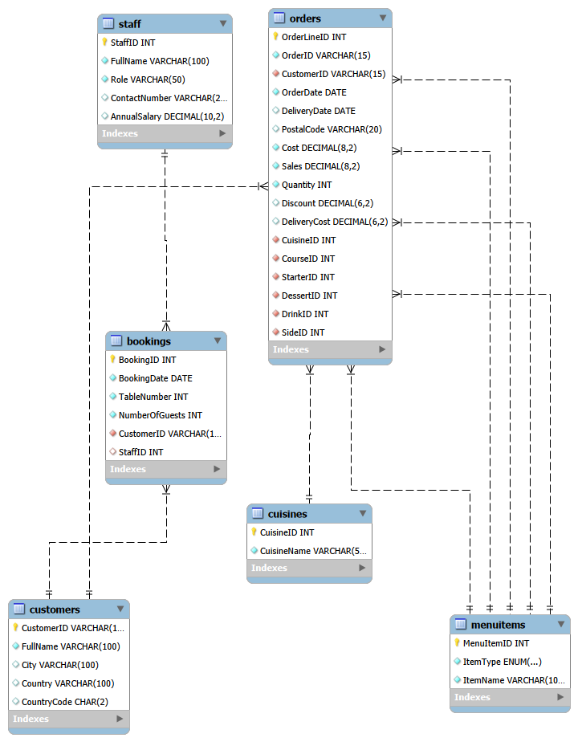
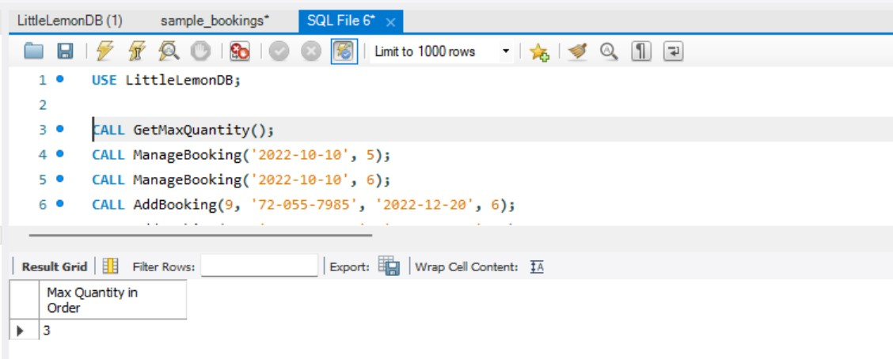
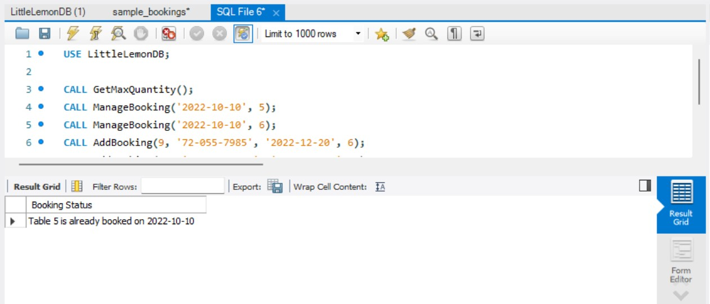
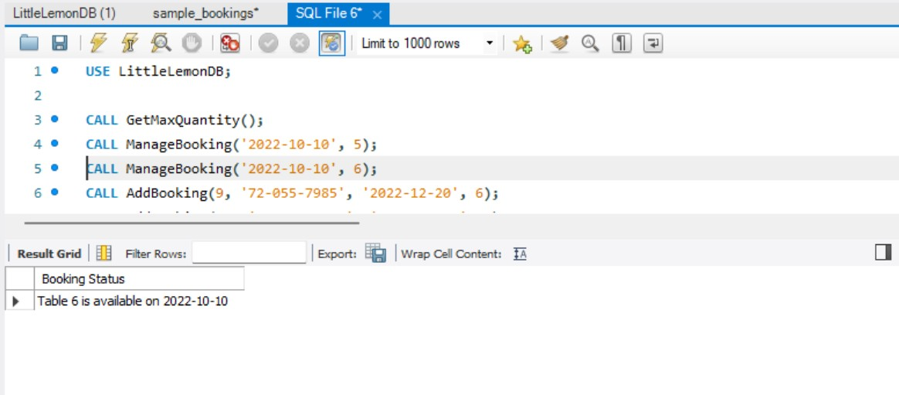
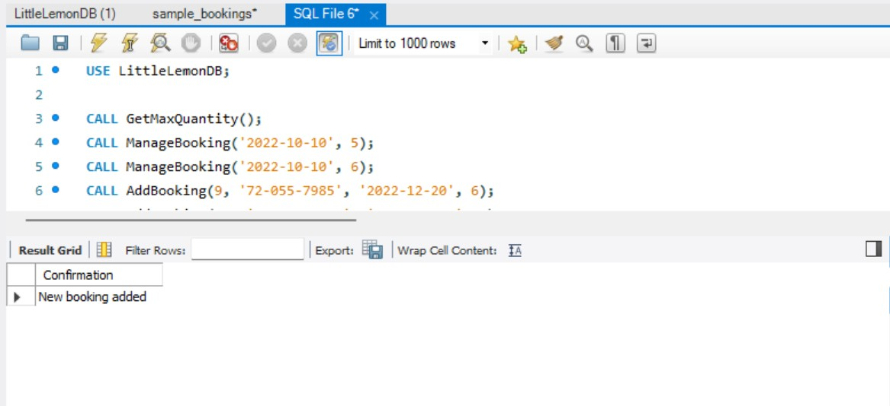
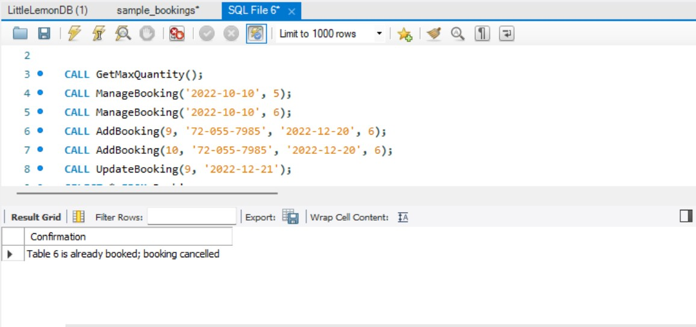
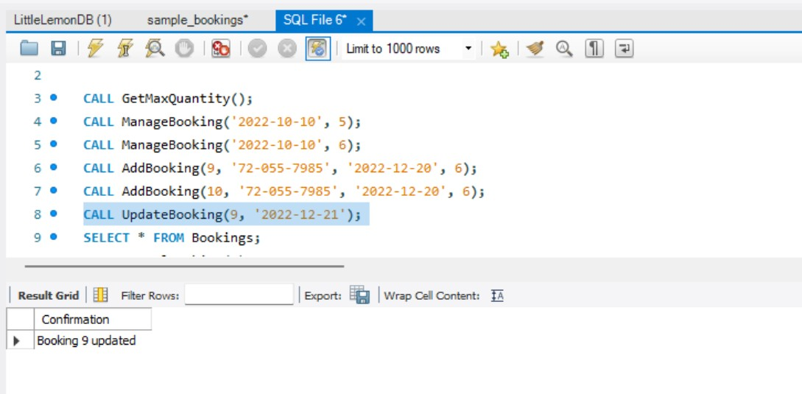
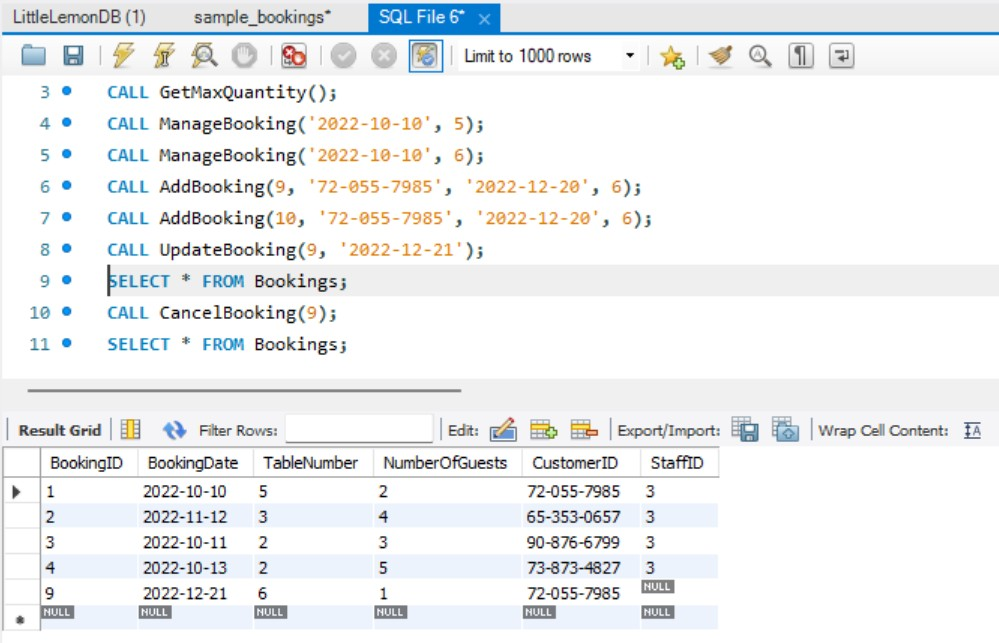
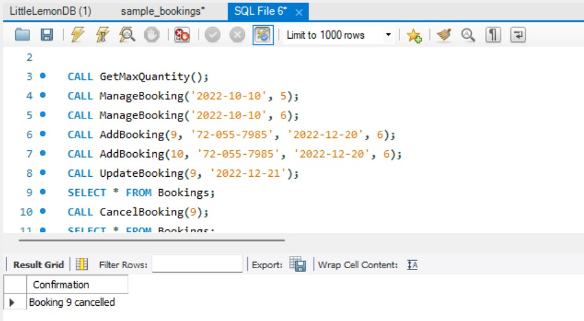
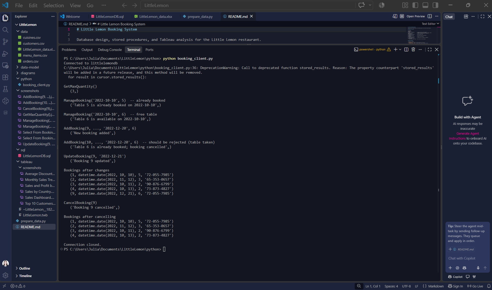

# 🍋 Little Lemon Booking System

A complete data project for the Little Lemon restaurant: a normalised **MySQL** database, **stored procedures**
for managing table bookings, a **Python** client, and an interactive **Tableau** sales dashboard built on
21,000 order records.


## Dashboard

[](tableau/LittleLemon.twbx)

**Highlights from the data**
- Total sales of about **$4.63M** and profit of about **$1.54M**, a margin of roughly **33%**.
- **Italian** dishes bring in about half of all sales (about $2.32M), with Greek and Turkish at about $1.1M each.
- China and Indonesia have the most order lines of any country.

## What's inside

| Component | Description |
|-----------|-------------|
| **Database** | 6 tables with primary and foreign keys, loaded with 21,000 orders and 1,000 customers |
| **Stored procedures** | `GetMaxQuantity`, `ManageBooking`, `UpdateBooking`, `AddBooking`, `CancelBooking` |
| **Python client** | Connects with `mysql-connector-python` and calls every procedure |
| **Tableau workbook** | 5 worksheets and a dashboard connected to the database |
| **Data pipeline** | `prepare_data.py` cleans the source spreadsheet into import-ready CSVs |

## Data model



- `Orders` links to `Customers`, `Cuisines` and (five times) `MenuItems` for course, starter, dessert, drink and side.
- `Bookings` links to `Customers` and `Staff`.
- A unique key on (`BookingDate`, `TableNumber`) makes double-booking impossible at the database level.

The Workbench model is in [`data-model/LittleLemonDM.mwb`](data-model/LittleLemonDM.mwb).

## Stored procedures

| Procedure | What it does | Example |
|-----------|--------------|---------|
| `GetMaxQuantity()` | Returns the largest quantity in any order | `CALL GetMaxQuantity();` |
| `ManageBooking(date, table)` | Reports whether a table is booked on a date | `CALL ManageBooking('2022-10-10', 5);` |
| `AddBooking(id, customer_id, date, table)` | Adds a booking in a transaction and rejects double-booking | `CALL AddBooking(9, '72-055-7985', '2022-12-20', 6);` |
| `UpdateBooking(id, new_date)` | Moves a booking to a new date, checking for conflicts | `CALL UpdateBooking(9, '2022-12-21');` |
| `CancelBooking(id)` | Deletes a booking | `CALL CancelBooking(9);` |

<details>
<summary><b>Procedure output screenshots</b> (click to expand)</summary>

| | |
|---|---|
|  |  |
|  |  |
|  |  |
|  |  |

</details>

## Python client

[`python/booking_client.py`](python/booking_client.py) connects to the database and calls all five procedures.
The password is read from a prompt or the `LITTLELEMON_DB_PASSWORD` environment variable, never stored in code.



## Repository structure

```
LittleLemon/
├── sql/
│   ├── LittleLemonDB.sql       # schema, staff, 5 stored procedures
│   └── sample_bookings.sql     # test bookings (run after importing the CSVs)
├── data/                       # source spreadsheet + cleaned CSVs
├── data-model/                 # MySQL Workbench model (.mwb)
├── diagrams/                   # ER diagram
├── python/                     # Python client
├── tableau/                    # packaged workbook + worksheet screenshots
├── screenshots/                # procedure and client output
└── prepare_data.py             # spreadsheet -> clean CSVs
```

## Getting started

1. Run `sql/LittleLemonDB.sql` in MySQL Workbench. It creates the database, tables, staff and procedures.
2. Import the CSVs in `data/` with the Table Data Import Wizard, in this order:
   `cuisines.csv`, `menu_items.csv`, `customers.csv`, `orders.csv`.
3. Run `sql/sample_bookings.sql` to add test bookings.
4. Check it worked: `CALL GetMaxQuantity();` should return **3**.
5. Run the Python client:
   ```bash
   pip install mysql-connector-python
   python python/booking_client.py
   ```

To rebuild the CSVs from the spreadsheet:
`pip install pandas openpyxl unidecode` then `python prepare_data.py data/LittleLemon_data.xlsx data`.

## Data notes

- The source has 21,000 rows but only 1,000 distinct Order and Customer IDs (each repeats 21 times with different
  cost and discount values), so `Orders` is keyed by `OrderLineID`, with `OrderID` indexed.
- Country code `NA` (Namibia) is kept as text, because spreadsheet tools often misread it as missing.
- 164 customer rows had garbled accented text, which `prepare_data.py` repairs and converts to plain ASCII.
- About 45% of rows have a delivery date earlier than the order date in the source. These are left unchanged.

## Tools

MySQL 8 · MySQL Workbench · Python (pandas, mysql-connector-python) · Tableau Desktop · Git

## License

Released under the [MIT License](LICENSE).
